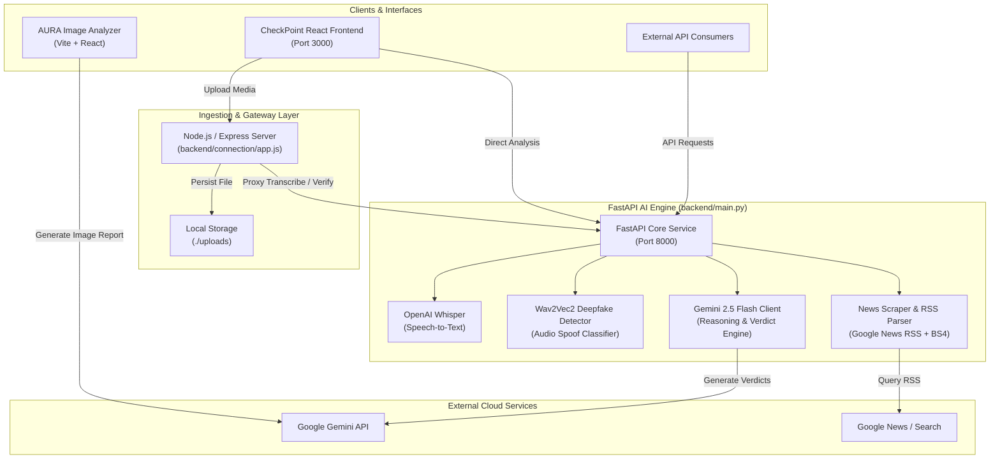

# 🛡️ CheckPoint — Multi-Modal Misinformation & Authenticity Detector

[](https://fastapi.tiangolo.com/)
[](https://reactjs.org/)
[](https://vitejs.dev/)
[](https://nodejs.org/)
[](https://ai.google.dev/)
[](https://huggingface.co/)
[](https://github.com/openai/whisper)

**CheckPoint** is a multi-modal AI platform designed to detect misinformation, fake news, and synthetic/manipulated media across **text**, **audio**, and **images**. Combining real-time search indexing, foundation models (Google Gemini), local deep learning inference (OpenAI Whisper & Hugging Face Wav2Vec2), and an interactive analytics interface, CheckPoint delivers evidence-backed credibility assessments with transparent reasoning.

---

## 📑 Table of Contents

- [Key Features](#-key-features)
- [System Architecture](#-system-architecture)
- [Repository Structure](#-repository-structure)
- [Tech Stack](#-tech-stack)
- [Prerequisites](#-prerequisites)
- [Setup & Installation](#-setup--installation)
  - [1. Backend (FastAPI AI Engine)](#1-backend-fastapi-ai-engine)
  - [2. Node Connection Gateway](#2-node-connection-gateway)
  - [3. Frontend Web Application](#3-frontend-web-application)
  - [4. Image Detection Module (AURA)](#4-image-detection-module-aura)
- [Environment Configuration](#-environment-configuration)
- [API Reference](#-api-reference)
- [Roadmap](#-roadmap)
- [License](#-license)

---

## 🚀 Key Features

### 1. 📰 Text & News Fact-Checking
- **Automated Entity & Claim Extraction**: Breaks down complex statements into verifiable keywords and core propositions.
- **Live Google News RSS Aggregation**: Queries current news feeds for corroborating or conflicting articles across trusted news agencies (e.g., BBC, NDTV, Deccan Herald).
- **Automated Web Scraping**: Extracts article context using BeautifulSoup to feed live ground truth into the evaluation model.
- **Credibility Scoring & Stance Analysis**: Calibrates a 0–100 credibility rating based on supporting vs. contradicting reporting, source reputability, and sensationalist penalty modifiers.
- **Visual Source Lineage Graph**: Maps the original claim against cited articles with explicit relationship classifications (`Supports` vs. `Conflicts`).

### 2. 🎙️ Audio Transcription & Deepfake Detection
- **Speech-to-Text Transcription**: Employs OpenAI's Whisper model (`whisper-base`) to accurately transcribe recorded or uploaded voice clips.
- **Voice Deepfake / Spoof Classification**: Integrates `abhishtagatya/wav2vec2-base-960h-asv19-deepfake` to distinguish genuine speech (`bonafide`) from synthetic or cloned audio (`spoof`).
- **End-to-End Pipeline**: Automatically pipes transcribed audio into the fact-checking engine for immediate claim verification.

### 3. 🖼️ Image Authenticity & Context Analysis (AURA)
- **Forensic Artifact Examination**: Detects anomalies typical of generative image models (DALL-E, Midjourney, Stable Diffusion), such as unnatural anatomy, eye reflections, blurred edges, lighting inconsistencies, and repeating textures.
- **Google Search Grounding**: Cross-references image claims and visual depictions with Google Search to identify out-of-context reuse of real imagery.
- **Two-Tiered Verdict**: Outputs both an **Image Authenticity Assessment** (AI-Generated vs. Photographic) and a **Context Verification** (True, Misleading, False, or Unverified).

### 4. 📊 Interactive Analytics Dashboard
- Dynamic confidence and originality visual gauges powered by Recharts and Framer Motion.
- Timeline virality curves and multi-platform media monitoring links (X, YouTube, Instagram, WhatsApp channels).
- Developer portal with custom API key provisioning (Production & Dev keys).

---

## 🏗️ System Architecture



---

## 📁 Repository Structure

```text
misinfo-detector/
├── backend/
│   ├── connection/
│   │   ├── app.js               # Express.js upload & orchestration gateway
│   │   ├── package.json         # Node dependencies (multer, express, axios, cors)
│   │   └── package-lock.json
│   ├── UTILS/
│   │   ├── api.py               # Gemini prompt logic, scoring, and retry handlers
│   │   └── content.py           # Google News RSS scraper & HTML parser
│   ├── main.py                  # Primary FastAPI service & endpoints
│   ├── requirements.txt         # Python dependencies
│   └── index.html               # Demo landing page
├── frontend/
│   ├── public/                  # Static assets & HTML template
│   ├── src/
│   │   ├── assets/              # Icons, illustrations, and background graphics
│   │   ├── components/          # UI components (Navbar, Sidebar, ResultCard, etc.)
│   │   ├── pages/
│   │   │   ├── MainScreen.jsx   # Multi-modal input page
│   │   │   ├── Results.jsx      # Analytics, charts, & lineage graph view
│   │   │   └── ProductionPage.jsx # API key generation & developer portal
│   │   ├── utils/
│   │   │   └── links.js         # Verified news channel cross-references
│   │   ├── App.jsx              # Router & animated transitions
│   │   └── index.js             # Application entry point
│   ├── package.json             # React dependencies & CRA configuration
│   └── tailwind.config.js       # Styling configuration
├── image-detection/
│   ├── components/              # Image uploaders, loaders, and report cards
│   ├── services/
│   │   └── geminiService.ts     # AURA analysis service with Google GenAI SDK
│   ├── App.tsx                  # Standalone AURA image forensic interface
│   ├── vite.config.ts           # Vite bundler configuration
│   ├── tsconfig.json            # TypeScript configuration
│   └── package.json             # Image detection module dependencies
├── .gitignore                   # Ignore rules for models, venvs, and build outputs
├── requirements.txt             # Root requirements
└── README.md                    # Project documentation
```

---

## 💻 Tech Stack

| Domain | Technologies & Libraries |
| :--- | :--- |
| **Backend AI Engine** | Python 3.10+, [FastAPI](https://fastapi.tiangolo.com/), [Uvicorn](https://www.uvicorn.org/), Requests, BeautifulSoup4, LXML |
| **Machine Learning / AI** | [Google Gemini 2.5](https://ai.google.dev/), [OpenAI Whisper](https://github.com/openai/whisper), [Transformers](https://huggingface.co/docs/transformers) (`wav2vec2`) |
| **Middleware Gateway** | [Node.js](https://nodejs.org/), [Express](https://expressjs.com/), [Multer](https://github.com/expressjs/multer), Axios, CORS |
| **Primary Frontend** | [React 19](https://react.dev/), [Tailwind CSS](https://tailwindcss.com/), [Framer Motion](https://www.framer.com/motion/), [Recharts](https://recharts.org/), Lucide React |
| **Forensic Image UI** | [Vite](https://vitejs.dev/), [TypeScript](https://www.typescriptlang.org/), `@google/genai` |

---

## ⚙️ Prerequisites

Before getting started, ensure you have the following installed on your machine:
- **Python**: Version `3.10` or higher ([Download](https://www.python.org/downloads/))
- **Node.js**: Version `18.x` or higher and `npm` ([Download](https://nodejs.org/))
- **FFmpeg**: Required for audio decoding in Whisper (`brew install ffmpeg` on macOS, or `sudo apt install ffmpeg` on Ubuntu)
- **Google Gemini API Key**: Obtainable from [Google AI Studio](https://aistudio.google.com/)

---

## 🛠️ Setup & Installation

### 1. Backend (FastAPI AI Engine)

Navigate to the `backend` directory, set up a Python virtual environment, and install dependencies:

```bash
cd backend

# Create and activate virtual environment
python3 -m venv .venv
source .venv/bin/activate  # On Windows: .venv\Scripts\activate

# Install required packages
pip install --upgrade pip
pip install -r requirements.txt
```

Launch the FastAPI server:

```bash
uvicorn main:app --host 0.0.0.0 --port 8000 --reload
```

The API docs will be accessible at: `http://localhost:8000/docs`

---

### 2. Node Connection Gateway

The Express gateway handles file uploads and acts as a bridge for audio processing:

```bash
cd backend/connection

# Install dependencies
npm install

# Start the gateway
node app.js
```

By default, the gateway runs on the port defined in your `.env` (e.g. `http://localhost:5000`).

---

### 3. Frontend Web Application

The primary React interface provides the fact-checking dashboard:

```bash
cd frontend

# Install dependencies
npm install

# Start the local development server
npm start
```

The app will launch in your browser at `http://localhost:3000`.

---

### 4. Image Detection Module (AURA)

To run the dedicated image authenticity analyzer:

```bash
cd image-detection

# Install dependencies
npm install

# Start the Vite development server
npm run dev
```

The AURA interface will be accessible at the Vite local address (typically `http://localhost:5173`).

---

## 🔐 Environment Configuration

Create `.env` files in their respective folders as described below:

### `backend/.env`
```env
# Gemini API Key for claim verification and keyword analysis
GEMINI_API_KEY=your_gemini_api_key_here
```

### `backend/connection/.env`
```env
PORT=5000
FLASK_SERVER=http://localhost:8000
```

### `frontend/.env`
```env
REACT_APP_BACKEND_URL=http://localhost:5000
```

### `image-detection/.env.local`
```env
API_KEY=your_gemini_api_key_here
```

---

## 📡 API Reference

### FastAPI Core Service (`http://localhost:8000`)

#### `POST /verify_news`
Extracts entities from user text, crawls Google News RSS, and computes a comprehensive credibility analysis.
```json
// Request Body
{
  "text": "Breaking news: Election machines in district 4 have been reportedly tampered with."
}

// Response
{
  "keywords": ["Election machines", "district 4", "tampered"],
  "articles_used": 6,
  "analysis": {
    "verdict": "Conflicting or Uncorroborated Claims",
    "confidence_score": 35,
    "confidence_score_calculation": "Base 50 - 15 points for lack of credible corroboration.",
    "reasons": [
      "No major journalistic outlet confirms tampering in district 4.",
      "Local election commission issued an official denial statement."
    ],
    "what_would_change": "Official forensic audit or report from verified electoral observer.",
    "lineage_graph": {
      "claim": "Election machines tampered with",
      "connections": [
        {
          "source": "BBC News",
          "url": "https://bbc.com/...",
          "title": "Local election commission confirms secure voting",
          "link_type": "Conflicts"
        }
      ]
    }
  }
}
```

#### `POST /get-audio`
Transcribes an audio file into text using OpenAI Whisper.
```json
// Request Body
{
  "path": "./uploads/audio_sample.mp3"
}

// Response
{
  "text": "Transcribed voice recording content..."
}
```

#### `POST /check-ai`
Runs audio classification on an audio file to determine if the speaker is authentic or synthetic.
```json
// Request Body
{
  "path": "./uploads/voice_clip.wav"
}
```

#### `POST /v1/analyze`
Lightweight multi-part endpoint accepting either direct text or image uploads with metadata.

---

### Node Gateway (`http://localhost:5000`)

| Method | Endpoint | Description |
| :--- | :--- | :--- |
| `POST` | `/upload` | Receives multipart/form-data file and stores in `./uploads/` |
| `POST` | `/get-audio-description` | Proxies file path to FastAPI `/get-audio` |
| `POST` | `/get-audio-analysis` | Proxies transcribed text to FastAPI `/verify_news` |

---

## 🗺️ Roadmap

- [ ] **Video Forensics**: Implement automated frame extraction and facial temporal-consistency checking for deepfake video detection.
- [ ] **Multilingual Support**: Extend Whisper and news scrapers to support regional languages (Hindi, Kannada, Tamil, Spanish, etc.).
- [ ] **Browser Extension**: Real-time Chrome/Firefox extension to verify news claims directly on social feeds (X, Reddit, Facebook).
- [ ] **Blockchain Provenance**: Immutable cryptographic verification timestamps for certified authentic journalism.

---

## 📄 License

This project is licensed under the [MIT License](LICENSE) — see repository details for full terms.
